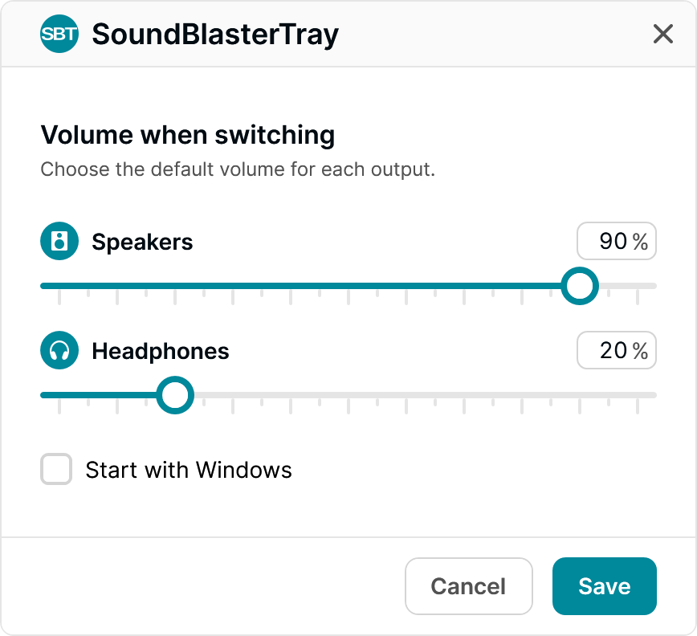
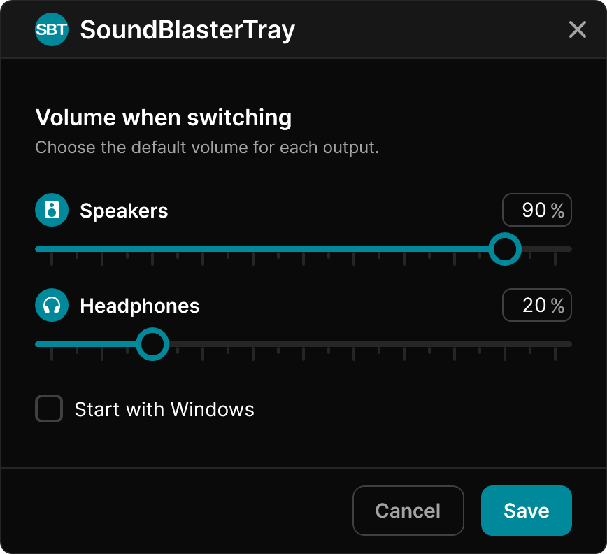

# SoundBlasterTray — speaker & headphone switcher for Creative

**Your Sound Blaster output, one tray click away.**

Using Sound Blaster Command (SB Command) to switch between speakers and headphones? SoundBlasterTray puts that everyday action in the Windows system tray, so you can switch without opening the Command window each time. Set a separate default volume for each output and keep your headphones at your preferred level.

A small, free Windows 11 utility for compatible Creative sound cards. Tested on Sound Blaster Z SE. The application EXE is under 1 MB, with light and dark themes that follow Windows.

[Download the latest release](https://github.com/kmdavydov/SoundBlasterTray/releases/latest) · [Русский](README.ru.md) · [Report an issue](https://github.com/kmdavydov/SoundBlasterTray/issues)

By [kmdavydov](https://github.com/kmdavydov). An independent community utility, not affiliated with or endorsed by Creative. Source code is not published in this repository.

## Preview

| Light | Dark |
|---|---|
|  |  |

## Features

- Left-click the tray icon to switch speakers and headphones.
- Right-click for Settings and Exit; Retry switching appears after a failed switch.
- Set separate volume levels for speakers and headphones.
- Temporary muting and volume checks during switching.
- Optional startup with Windows.
- Automatic light/dark theme based on the Windows app theme.
- Russian UI on Russian Windows display languages; English otherwise.
- Automatic detection of compatible Creative devices, with explanations when switching is unavailable.

## Requirements and compatibility

- Windows 11 x64 and .NET Framework 4.8 or later.
- A compatible Creative audio device with its Creative driver installed.
- The driver must expose compatible SoundCore output switching and endpoint volume controls. Having Sound Blaster Command installed alone does not guarantee compatibility.

**Physically tested: Sound Blaster Z SE.** Other Creative models are detected by capabilities but have not been physically verified. Windows on ARM and audio paths bypassing the Windows mixer, such as ASIO, have not been validated. Creative drivers and DLLs are not included.

## Does this replace Sound Blaster Command?

No. SoundBlasterTray is a focused companion for people who use Sound Blaster Command: it handles speaker/headphone switching and the volume applied during a switch. It does not replace Command's equalizer, effects or device configuration. It talks to the installed Creative driver rather than automating the Command window.

## Download and install

1. Open [Releases](https://github.com/kmdavydov/SoundBlasterTray/releases/latest).
2. Under **Assets**, download `SoundBlasterTray-1.3.0-Setup.exe`. GitHub's automatically generated “Source code” archives contain this documentation, not the application.
3. Close a running SoundBlasterTray instance using **Exit** in its tray menu before installing or updating.
4. Run the installer. Installation is per-user and does not require administrator rights.
5. Open Settings and choose suitable volume levels before your first switch. Defaults: **speakers 90%, headphones 20%**.

This release is **not digitally signed**. Windows may display an unknown-publisher or SmartScreen warning. Download from this repository's Releases; do not disable Windows protection. `SHA256SUMS.txt` is provided alongside the installer for an integrity check.

## Usage

The utility runs next to the clock; Windows may place it in the hidden-icons area. A left-click starts switching. Wait until switching completes before trying again. A right-click opens the menu.

Saved volume values apply on the next switch, not immediately. Start with Windows is disabled by default and is enabled by saving the checkbox in Settings. Launching the app again opens Settings in the existing instance.

If switching fails, the tray icon shows a warning and a left-click opens the error explanation. **Retry switching** keeps the intended output after a partial failure. Audio is restored only after checks succeed; audio muted before the attempt stays muted.

The app follows Windows theme changes while running. Display language is selected at launch. External changes made in Sound Blaster Command are normally reflected within a few seconds.

## Settings and removal

Settings and the diagnostic log are stored in `%LOCALAPPDATA%\SoundBlasterTray` (`settings.xml` and `app.log`). Uninstall through Windows Settings after exiting the tray app. Your settings and log are retained; the installed copy's own startup entry is removed.

## Feedback

Use [Issues](https://github.com/kmdavydov/SoundBlasterTray/issues) to report problems or compatibility results. Include the app version, Creative model, driver version and Windows version. Review log excerpts before posting: remove personal paths, device identifiers and other private information.

## Terms and credits

Official binaries are free to use for personal and commercial purposes under [the binary-use terms](LICENSE.md). This is a binary-only distribution, not an open-source release.

Inter fonts and SoundCore ABI components retain their own licenses. See [third-party notices](THIRD_PARTY_NOTICES.md) and [Inter's license](licenses/Inter-OFL.txt).
