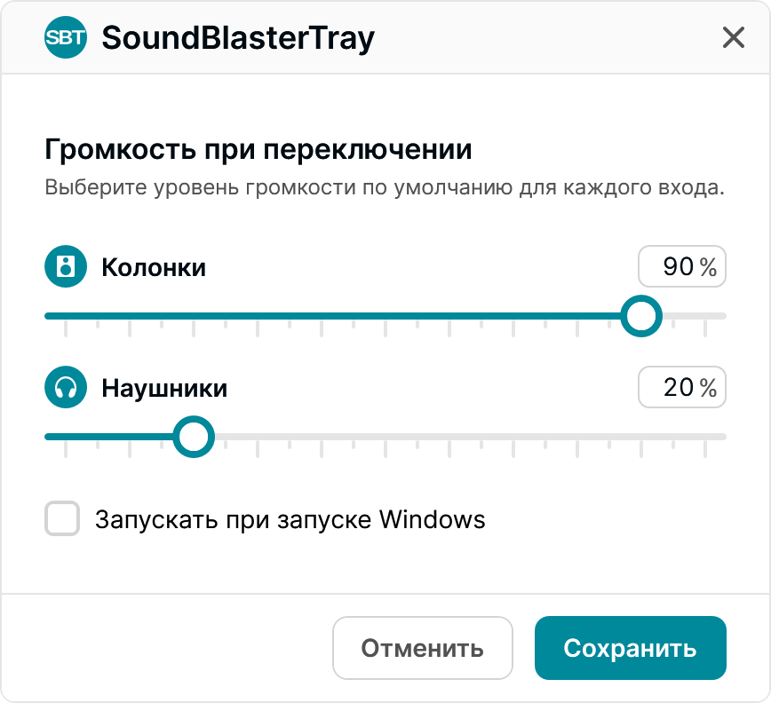
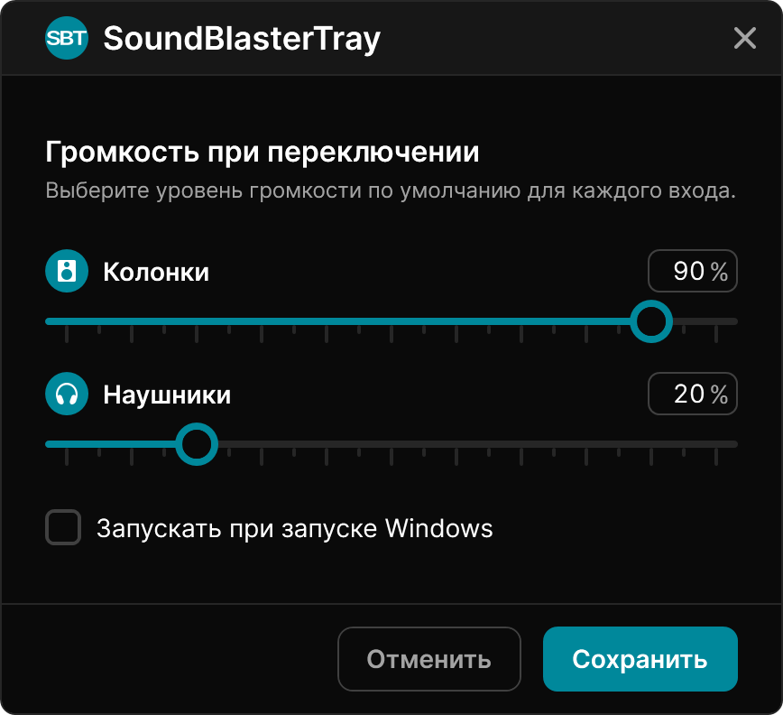

# SoundBlasterTray — переключение колонок и наушников Creative

**С колонок на наушники — одним кликом в трее.**

Открываете Sound Blaster Command (SB Command), чтобы переключить колонки и наушники? SoundBlasterTray переносит это действие прямо в трей Windows. Задайте отдельную громкость для каждого выхода — при переключении на наушники утилита применит выбранный для них уровень.

Небольшая бесплатная утилита для Windows 11 и совместимых звуковых карт Creative. Проверена на Sound Blaster Z SE. EXE приложения занимает меньше 1 МБ, а светлая и тёмная темы автоматически следуют настройкам Windows.

[Скачать последнюю версию](https://github.com/kmdavydov/SoundBlasterTray/releases/latest) · [English](README.md) · [Сообщить об ошибке](https://github.com/kmdavydov/SoundBlasterTray/issues)

Автор: [kmdavydov](https://github.com/kmdavydov). Независимая утилита, не связанная с Creative и не являющаяся её официальным продуктом. Исходный код в этом репозитории не публикуется.

## Интерфейс

| Светлая тема | Тёмная тема |
|---|---|
|  |  |

## Возможности

- Левый клик по значку переключает колонки и наушники.
- Правый клик открывает настройки и выход; после сбоя доступно «Повторить переключение».
- Отдельная громкость по умолчанию для каждого выхода.
- Временное приглушение и проверка громкости при переключении.
- Автозапуск вместе с Windows по желанию.
- Автоматический выбор светлой или тёмной темы Windows.
- Русский интерфейс для русского языка интерфейса Windows, английский для остальных.
- Автоопределение совместимых устройств Creative и понятные сообщения об ошибках.

## Требования и совместимость

- Windows 11 x64 и .NET Framework 4.8 или новее.
- Совместимое устройство Creative с установленным драйвером Creative.
- Драйвер должен предоставлять совместимые интерфейсы переключения SoundCore и управления громкостью выходов. Само наличие Sound Blaster Command не гарантирует совместимость.

**Физически проверена Sound Blaster Z SE.** Другие модели определяются по возможностям драйвера, но физически пока не проверены. Windows на ARM и режимы в обход микшера Windows, например ASIO, не проверены. Драйверы и DLL Creative в комплект не входят.

## Заменяет ли это Sound Blaster Command?

Нет. SoundBlasterTray дополняет привычный сценарий работы с Sound Blaster Command: переключает колонки и наушники и применяет заданную громкость. Эквалайзер, эффекты и настройка устройства остаются в Command. Утилита обращается к установленному драйверу Creative, а не управляет окном Command.

## Установка

1. Откройте [Releases](https://github.com/kmdavydov/SoundBlasterTray/releases/latest).
2. В разделе **Assets** скачайте `SoundBlasterTray-1.3.0-Setup.exe`. Автоматические архивы GitHub «Source code» содержат документацию этой страницы, а не программу.
3. Перед установкой или обновлением закройте запущенную утилиту через «Выход» в меню трея.
4. Запустите установщик. Установка выполняется для текущего пользователя без прав администратора.
5. Перед первым переключением задайте подходящую громкость в настройках. Начальные значения: **колонки 90%, наушники 20%**.

У сборки **нет цифровой подписи**. Windows может показать неизвестного издателя или предупреждение SmartScreen. Скачивайте установщик из Releases этого репозитория; отключать защиту Windows не нужно. Рядом с установщиком опубликован `SHA256SUMS.txt` для проверки целостности файла.

## Использование

Значок находится рядом с часами или в скрытых значках Windows. Левый клик запускает переключение; дождитесь его завершения. Правый клик открывает меню.

Сохранение настроек не меняет текущую громкость: уровни применяются при следующем переключении. Автозапуск по умолчанию выключен; для включения отметьте флажок и сохраните настройки. Повторный запуск программы открывает настройки уже работающего экземпляра.

При ошибке появляется значок предупреждения; левый клик открывает описание проблемы. «Повторить переключение» сохраняет нужный выход после частичного сбоя. Звук восстанавливается только после успешных проверок; исходное пользовательское отключение звука сохраняется.

Тема обновляется вслед за темой приложений Windows. Язык определяется при запуске. Внешние изменения в Sound Blaster Command обычно отражаются в течение нескольких секунд.

## Настройки и удаление

Настройки `settings.xml` и журнал `app.log` хранятся в `%LOCALAPPDATA%\SoundBlasterTray`. Для удаления выйдите из утилиты и воспользуйтесь списком установленных приложений Windows. Настройки и журнал сохраняются; собственная запись автозапуска установленной копии удаляется.

## Обратная связь

В [Issues](https://github.com/kmdavydov/SoundBlasterTray/issues) можно сообщить об ошибке или результатах проверки другой модели. Укажите версию утилиты, модель Creative, версию драйвера и Windows. Перед публикацией фрагментов журнала удалите личные пути, идентификаторы устройств и другие приватные данные.

## Условия использования

Официальные сборки можно бесплатно использовать в личных и коммерческих целях на условиях [лицензии на использование готовой программы](LICENSE.md). Исходный код не открыт.

Шрифты Inter и заимствованные компоненты SoundCore ABI сохраняют собственные лицензии: [уведомления](THIRD_PARTY_NOTICES.md), [лицензия Inter](licenses/Inter-OFL.txt).
